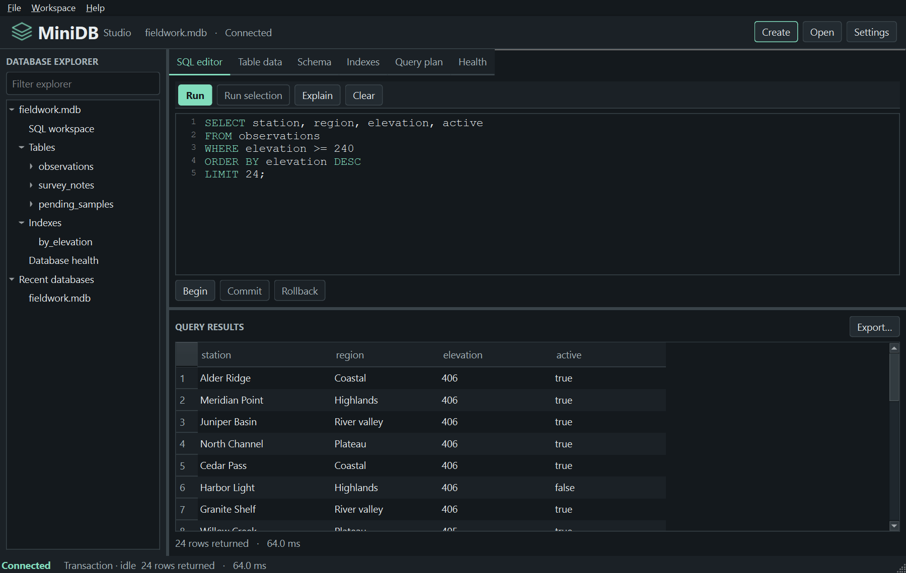

# MiniDB Studio & Storage Engine

MiniDB is a Python 3.11+ educational database engine with typed tables, a single-table SQL language, persistent B+ tree indexes, and transactions backed by a binary write-ahead log. Rows, schema definitions, and index nodes share one checksummed binary file. A permanent `.wal` companion stores redo during commit and recovery. The core uses only the standard library.

MiniDB Studio is the optional native desktop workspace for these local files. Browse tables and physical record IDs, run SQL, inspect actual B+ tree access paths, manage transactions and indexes, migrate legacy files, and check database integrity. The first launch opens an empty workspace.



[Studio user guide and screenshot gallery](docs/studio.md) · [0.4.0 release notes](docs/release-notes-0.4.0.md) · [Native GUI measurements](docs/studio-benchmarks.md)

## Install and run on Windows

Install MiniDB directly from the source repository using Git and Python 3.11 or later:

```powershell
git clone https://github.com/aadarsha-hiremath/minidb-studio.git
cd minidb-studio
py -3 -m venv .venv
.\.venv\Scripts\python.exe -m pip install .
.\.venv\Scripts\minidb.exe --help
```

An existing checkout can start at the `py` command. The console entry point also works as `python -m minidb` with the installed interpreter.

For Studio, add the optional PySide6 Widgets dependency and launch the installed application:

```powershell
.\.venv\Scripts\python.exe -m pip install ".[gui]"
.\.venv\Scripts\minidb.exe --version
.\.venv\Scripts\minidb-gui.exe
```

The Windows launcher uses this environment's Python and Qt libraries. Linux desktop users can run `python3 -m venv .venv`, `.venv/bin/python -m pip install ".[gui]"`, and `.venv/bin/minidb-gui` from the checkout. A working Qt platform plugin and a display are needed for interactive use. The engine CLI runs without Qt.

Studio shares one exclusive session across its editor, transaction controls, and explorer. Ctrl+Enter executes one statement. Click a table to browse 128 records at a time. Select a row to inspect it, or export a complete SQL result of up to 2,000 rows as CSV or JSON. Settings saves theme, density, typeface, layout, columns and recent files locally. [Navigation, safety boundaries and manual verification](docs/studio.md).

## Try an indexed SQL query

Run these against a new file. Each invocation starts a fresh process, reopens the file, and validates the persisted index before using it.

```powershell
$mini = ".\.venv\Scripts\minidb.exe"
& $mini create school.mdb
& $mini sql school.mdb "CREATE TABLE students (id INT, name TEXT)"
& $mini sql school.mdb "INSERT INTO students VALUES (101, 'Ada')"
& $mini sql school.mdb "CREATE INDEX students_id ON students(id)"
& $mini sql school.mdb "EXPLAIN SELECT name FROM students WHERE id = 101"
# Index Scan using students_id on students
& $mini sql school.mdb "SELECT name FROM students WHERE id = 101"
# {"rows": [{"name": "Ada"}], "rowcount": 1}
& $mini check school.mdb
# ok
```

The Python equivalent is `db.execute("SELECT name FROM students WHERE id = ?", (101,)).rows`. SQL supports CREATE TABLE, INSERT, SELECT, UPDATE, DELETE, CREATE INDEX, DROP INDEX, and EXPLAIN SELECT. Comparisons and AND, one ORDER BY column, and LIMIT are available. [Grammar, binding and planning](docs/sql.md) · [B+ tree design and validation](docs/indexes.md).

## Commit and roll back in one session

Use a fresh filename. Each input line is one SQL statement. The session holds the lock across all lines. A standalone `sql` invocation handles one statement and closes its handle.

```powershell
$mini = ".\.venv\Scripts\minidb.exe"
& $mini create bank.mdb
@'
BEGIN
CREATE TABLE accounts (id INT, balance INT)
INSERT INTO accounts VALUES (1, 100)
CREATE INDEX accounts_id ON accounts(id)
COMMIT
BEGIN
UPDATE accounts SET balance=0 WHERE id=1
ROLLBACK
'@ | & $mini session bank.mdb

& $mini sql bank.mdb "SELECT balance FROM accounts WHERE id=1"
# {"rows": [{"balance": 100}], "rowcount": 1}
& $mini status bank.mdb
& $mini check bank.mdb
# ok
```

The Python API supports `db.begin()`, `db.commit()`, `db.rollback()`, and `db.transaction_state`. A transaction context commits on normal exit and rolls back on an exception.

```python
from minidb import Database

with Database.open("bank.mdb") as db:
    with db.transaction():
        db.execute("UPDATE accounts SET balance=? WHERE id=?", (80, 1))
        print(db.execute("SELECT balance FROM accounts WHERE id=?", (1,)).rows)
```

## Use the record CLI

Choose a new filename. Each command below starts a process, opens the database, performs one operation, and closes the file. An existing file makes `create` fail.

```powershell
$mini = ".\.venv\Scripts\minidb.exe"
& $mini create demo.mdb
& $mini create-table demo.mdb notes number:int title:text saved:bool
& $mini insert demo.mdb notes number=7 "title=Storage works" saved=true
# 2:0
& $mini get demo.mdb notes 2:0
# {"number": 7, "title": "Storage works", "saved": true}
& $mini tables demo.mdb
& $mini schema demo.mdb notes
& $mini update demo.mdb notes 2:0 number=7 "title=Reopened" saved=true
& $mini scan demo.mdb notes
# {"rid": "2:0", "row": {"number": 7, "title": "Reopened", "saved": true}}
& $mini delete demo.mdb notes 2:0
```

The CLI emits one JSON object per scanned row. It reports engine errors on stderr and exits with status 1. Invoke any command with `--help` for its arguments.

## Python API

```python
from minidb import Column, Database, Schema

with Database.create("library.mdb") as db:
    db.create_table(Schema("books", (Column("title", "text"), Column("pages", "int"))))
    rid = db.insert("books", {"title": "Database Internals", "pages": 376})

with Database.open("library.mdb") as db:
    print(db.get("books", rid))
    db.update("books", rid, {"title": "Database Internals", "pages": 377})
    for physical_id, book in db.scan("books"):
        print(physical_id, book)
    db.delete("books", rid)
```

`RecordID(page, slot)` identifies a physical location in one database. Updates preserve the ID. Names and values such as the example's `number` are ordinary fields and may repeat. There are no logical primary keys. Table names and column names are case-sensitive ASCII identifiers matching `[A-Za-z_][A-Za-z_0-9]{0,62}`. Each table requires 1–63 uniquely named columns and a schema that fits one catalog page.

| Type | Accepted value |
| --- | --- |
| `int` | Signed 64-bit Python integer. Booleans are rejected. |
| `text` | Strict UTF-8 string, including empty strings and embedded NULs. |
| `bool` | Python `True` or `False`. CLI spelling is `true` or `false`. |

All columns are required for inserts and updates. Missing, extra, null, and incorrectly typed values raise `ValidationError`. A missing table or record raises `NotFound`. Expected engine errors derive from `DatabaseError`.

## Storage architecture

| Module | Responsibility |
| --- | --- |
| `cli` | Parse command arguments and render results. |
| `sql` and `executor` | Tokenize and parse statements into typed syntax trees, bind values, select an access path, and evaluate queries. |
| `btree` | Encode index keys, route searches through disk pages, split nodes, maintain leaf entries, and validate persisted trees. |
| `database` | Apply table operations, route record IDs, and iterate pages in physical order. |
| `schema` and `catalog` | Validate typed rows and serialize schemas into dedicated catalog pages. |
| `pages` and `binary` | Pack slotted data pages, bound field reads, and compute CRC-32. |
| `pager` | Own the file pair, exclusive locks, transaction overlay, page allocation, and checkpoint lifecycle. |

The v3 database starts with an immutable identity page and separate completed and intended checkpoint stamps. The `wal` module serializes full-page redo, validates commit markers and installs checkpoints. Tagged pages hold schemas, table records, index definitions, tree nodes, and retired space. Opening validates all pages, decodes every live row, checks index coverage, and retains a catalog of names, roots, and table page IDs. A record lookup reads its target page directly. Inserts use the first table page with space, then append a page if necessary. Table scans visit live records by ascending page and slot. A mutation invalidates a scan in progress.

The maximum encoded row is **4,074 bytes**, including field lengths. Delete compacts the payload and retains a four-byte tombstone. A growing update that cannot fit its original page raises `NoSpace` and preserves the old record. The byte-level specification includes offsets, type tags, allocation order, and validation rules. [Read the file format](docs/format.md).

## Durability and compatibility

A successful write outside an explicit transaction commits the complete record operation or SQL statement. The exclusive handle sees its own tentative writes. Commit synchronizes the WAL before installing a checkpoint. Recovery runs on open while both files are locked. Errors during commit report a known abort, an uncertain outcome, or a committed change awaiting recovery. Reopen and inspect the result before retrying an uncertain operation. [Protocol, file layout, diagrams and error handling](docs/transactions.md).

New databases use format v3. Existing v1 databases from Phases 1 and 2 open for inspection and queries. To enable writes, run `minidb migrate original.mdb upgraded.mdb` with a fresh destination. The source is validated and retained as a backup. Migration preserves record IDs and indexes. For a v3 backup, validate and close the database, keep other writers out, then copy **both** the main file and its clean WAL. A pending WAL is bound to the original file identity.

The engine supports one process and thread per open handle on a local filesystem. A transaction may dirty 4,096 distinct pages (16 MiB of page images). Indexed text fits 240 UTF-8 bytes. Empty leaves and retired pages stay allocated. Joins, aggregation, savepoints, MVCC, and simultaneous readers remain outside this release. Physical power-loss behavior depends on filesystem and hardware sync guarantees.

## Test and measure

The Studio tests require the GUI extra. Set `$env:QT_QPA_PLATFORM='offscreen'` for headless Qt testing; remove that variable before an interactive launch.

```powershell
.\.venv\Scripts\python.exe -m unittest discover -s tests -v
.\.venv\Scripts\python.exe -m unittest discover -s tests/studio -v
.\.venv\Scripts\python.exe -m unittest discover -s tests -p test_recovery.py -v
.\.venv\Scripts\python.exe examples/recovery.py
.\.venv\Scripts\python.exe benchmarks/transactions.py --sizes 16 64 256 --iterations 3
.\.venv\Scripts\python.exe benchmarks/storage.py --rows 1500 --iterations 3
.\.venv\Scripts\python.exe benchmarks/indexing.py --sizes 250 1000 3000 --iterations 3
```

The recovery demo terminates real child processes on disposable files and prints recovered balances. [Phase 3 transaction measurements](docs/transaction-benchmarks.md).

The suite uses temporary files, seeded CRUD models, indexed and sequential query oracles, separately launched CLI processes, deliberately malformed checksummed pages, and injected I/O failures. CI runs the suite on Linux and Windows for Python 3.11–3.15. The index benchmark reports query time, maintenance cost, full-validation reopen time, and file size. [Phase 2 benchmark measurements](docs/benchmarks.md).

The historical Phase 1 baseline below used `storage.py` on 1,500 integer/text rows. It fetched every record in seeded shuffled order, scanned every row, and verified values outside the timed regions. Create and bulk insert included close and sync. Table creation was outside the insert measurement. OS caches remained enabled.

| Operation | Median of 3 iterations |
| --- | ---: |
| Create empty database | 2.410 ms |
| Insert 1,500 rows | 264.749 ms |
| Fetch 1,500 rows | 42.783 ms |
| Scan 1,500 rows | 1.816 ms |
| Reopen populated database | 5.922 ms |
| Final file size | 49,152 bytes |

Measured on Windows 11 build 26300, Intel Core i7-14650HX (24 logical CPUs), CPython 3.15.2. The script prints individual runs, platform details, and medians.

## Distribution and licensing

This repository provides the MiniDB engine and Studio
source code. Install the application using Python.

No standalone Windows executable or installer is
provided in this source-only release.

MiniDB source code is licensed under the
[MIT License](LICENSE). The optional Studio GUI
uses separately licensed PySide6/Qt dependencies.

The engine is intended for educational use, with
single-owner local database access and a limited
SQL feature set.

