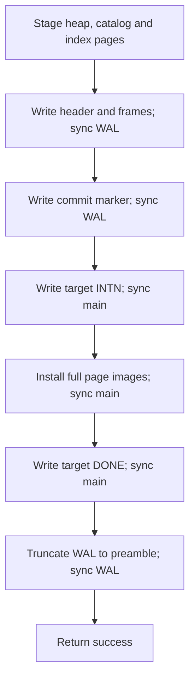
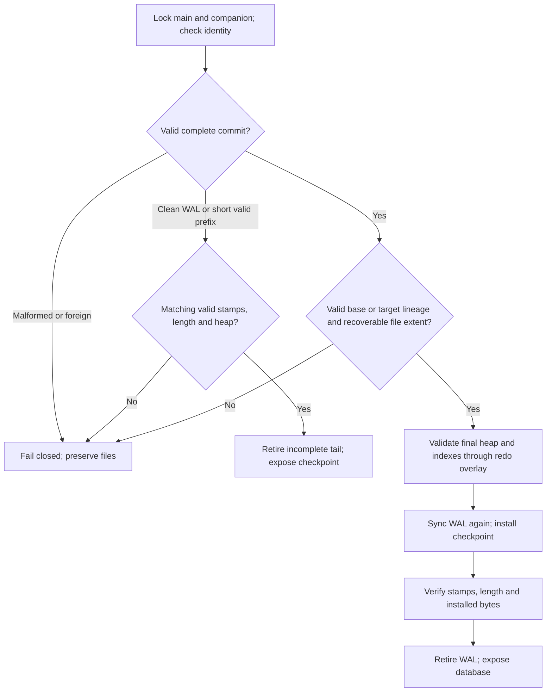

# Transactions and recovery

## Architecture decision

The Phase 2 audit traced schema creation, heap CRUD, page compaction, page allocation, index creation/retirement, sibling splits and root publication to two pager methods. The SQL executor can call these paths many times per statement. Phase 3 wraps the complete public mutation or SQL statement in one transaction. The pager retains the last full image of each dirty logical page and a tentative page count. Reads consult this overlay first. Rollback discards it and reloads catalog, index roots and counts from the checkpoint. The single process/thread owner holds the exclusive database lock throughout recovery and normal access.

The redo protocol permits one transaction at a time in a permanent companion file. A random database identity lives in an immutable main-file anchor and the WAL preamble. Two separately synced main-file stamps record installation intent and completed checkpoint. Each generation includes a sequence, logical page count and fresh nonce. A commit names its base and target. A WAL from a different physical file cannot replay, including a diverged copy with the same database UUID.

Commit writes checksummed full-page images, syncs the prepared log, writes a digest-bearing commit marker, and syncs it. Checkpoint syncs the target intent stamp before installing any heap, catalog or tree page. It syncs those pages before publishing and syncing the completed stamp. Only then may it truncate and sync the WAL back to its identity preamble. A valid commit is replayable until checkpoint finishes. Recovery validates the complete record before installing a page, validates the prospective heap and all indexes using the WAL overlay, and reads back the installed images before retiring recovered redo. A short uncommitted tail can be discarded only when the main stamps agree and the main file length matches the checkpoint.

Format v3 requires explicit copy migration for v1 files. The original remains the backup. Schema, data and index pages retain their logical IDs and bytes. Transactions provide atomic statement and transaction outcomes and exclusive isolation. Durability depends on local filesystem ordering and honest sync completion. Fault injection tests process interruption and storage errors. Physical power removal is outside the test model.

## Transaction states

| State | Operations and transitions |
| --- | --- |
| Idle | Reads use the completed checkpoint. BEGIN starts an empty overlay. Each standalone mutation owns an implicit transaction. A read-only or empty commit performs no WAL I/O. |
| Active | All operations share the tentative page count and latest images. COMMIT publishes the generation. ROLLBACK discards it. A failed mutation, SQL parse, or SQL query makes the transaction rollback-only. |
| Rollback-only | Data operations and commit are rejected. ROLLBACK returns to idle and refreshes in-memory catalog and index state. |
| Failed commit or failed rollback reload | The handle rejects work. Close it and reopen under the exclusive lock. |

Nested BEGIN and transaction-end commands in the wrong state raise `TransactionError`. Invalid control transitions leave the outstanding transaction intact. Ordinary read-only record-API lookup errors do not mark it rollback-only. The Python context manager owns its transaction boundary: explicit commit, rollback, or close inside the context is rejected. If application code catches a statement error and exits a rollback-only context normally, the context rolls back and raises. Closing an unmanaged handle drops any uncommitted overlay. RIDs returned before commit are provisional and may be allocated again following rollback.

Every durable mutation of an existing database follows this path. Pager writes require an overlay and validate page checksum and logical ID. Allocation stages a full image and increments the tentative count. Commit coalesces repeated writes to one frame per page. Physical main-file writes occur only during exclusive bootstrap or redo checkpoint. All persistent tree changes, including root changes during a split, follow these pager methods. Single-table multi-row updates/deletes share the outer SQL statement's transaction.

## Binary layout

Unsigned integers are big-endian. All database pages and the permanent WAL preamble are 4,096 bytes with zero padding and a trailing CRC-32 over the first 4,092 bytes. Stamp bytes encode `u64 generation, u32 logical page count, 16-byte generation token`. Count includes reserved logical page zero. The initial generation is zero. Each dirty commit adds one and selects a new random token.

| File and offset | Contents |
| --- | --- |
| Main, 0 | Eight bytes `MINIDB\r\n` (hex `4d494e4944420d0a`), u16 version 3, u16 page size 4096, 16-byte database UUID. The anchor is published once. |
| Main, 4096 | `DONE` and the most recently completed checkpoint stamp. |
| Main, 8192 | `INTN` and the most recently intended checkpoint stamp. In a clean database the two stamps match. |
| Main, `4096 × (p + 2)` | Full checksummed storage page for logical page `p`, with `1 ≤ p < count`. Clean main length is `4096 × (count + 2)`. |
| WAL, 0 | `MDBWAL01` and the same UUID. A clean companion consists solely of this page. |
| WAL, 4096 | 100-byte transaction header: `TX01`, 16-byte database UUID, 16-byte physical-file binding, 28-byte base stamp, 28-byte target stamp, u32 frame count, u32 CRC-32 over the preceding 96 bytes. |
| WAL, 4196 | Sorted frames, each a u32 logical ID followed by its 4096-byte checksummed after-image. Unique IDs are positive and below target count. Every newly allocated ID must have a frame. |
| WAL, immediately after frames | 48-byte marker: `COMMIT01`, u64 target generation, SHA-256 over the exact header and all frames including IDs. No trailing records are permitted. |

The file binding is the first 16 bytes of SHA-256 of the ASCII decimal device number, slash and inode/file number obtained from the locked main descriptor. Pending WALs can only be replayed on that physical file. Use a local filesystem with stable file IDs. A cold, clean file pair can be copied because a clean WAL contains no transaction binding. Keep the original pair together until open/check succeeds.

Frame count is limited to 4096. Both writer memory and recovery frame loading are bounded by 16 MiB of page images plus bookkeeping. Before trusting frame counts, the reader caps total file length and validates the header checksum. It checks frame order, own IDs, image CRCs, allocation coverage, marker and whole-record digest. Integrity validation walks the candidate catalog, slotted pages and complete trees, verifying every index RID and coverage. These checks detect structural inconsistency; checksums and digests are not authentication against an adversary who can rewrite the files.

## Commit ordering

Checkpoint is automatic and synchronous for every dirty commit. Returning success requires all six file syncs. The durable commit point is the successful marker sync. If I/O fails earlier, `CommitError.outcome` is `uncommitted` before the marker write, or `unknown` from the start of the marker write through its sync. After acknowledged marker sync, a checkpoint or cleanup error reports `committed` even though the call raises. An error disables the handle. Reopen and inspect before retrying an uncertain operation. A process can also die after durable commit and before its caller receives a response.

## Recovery decisions

Open refuses a missing companion, extra WAL data, a bad full-sized marker, stale lineage, or a file truncated below the base extent. An incomplete tail with matching main stamps is discarded only after the checkpoint passes ordinary integrity checks. Since there is one synchronous checkpoint per transaction, older commits have already reached the main file before another transaction can leave a tail.

A torn DONE stamp can be reconstructed when the surviving intent matches the committed target. A torn intent can be repaired from the committed WAL and a matching completed stamp. Redo preserves a good target intent rather than overwriting the only surviving lineage stamp. Recovery re-syncs a complete marker observable after process death before replaying any page. Installing after-images is idempotent, including after a second process dies during recovery. An unrelated page failing validation, or loss of both usable lineage stamps, requires a known-good backup.

## Filesystem contract and migration

The lock covers open-time validation, recovery, queries and checkpoint. Cooperating readers also require the exclusive lock. Handles are bound to their opening process and thread. There are no concurrent snapshots or background checkpoints. The main file and WAL must be regular files on a local filesystem. Hard-linked transactional files and symlinked companions are rejected. External writers, replacement of live paths, and network file locking are outside this protocol.

Creation exclusively creates both paths. On POSIX it syncs their parent directory before publishing the anchor. The WAL identity and copied data/stamps are synced before the final anchor write and sync. On Windows, file handles are flushed through `os.fsync`; the Python implementation does not flush directory handles. An interrupted or failed creation may leave incomplete newly created paths. Preserve them for diagnosis and retry at a new destination. Never delete the WAL of an existing database to clear an error.

For a v1 database, run `minidb migrate original.mdb new.mdb`. Migration holds the source lock, validates the entire source, copies all logical storage pages to new physical offsets, publishes a fresh identity, and validates the result. Both destination paths must be new. The original file remains the backup. Phases 1 and 2 reject the v3 anchor. Phase 3 uses a writable file descriptor to acquire the same exclusive lock on v1 but forbids v1 mutations.

Back up only a healthy, closed pair with no other writer. After an interrupted commit, recover at the original path and verify integrity before moving or copying the pair. If durable media loses the only commit record, external tools replace files, or the device violates successful sync ordering, software cannot promise recovery. The tests exercise process termination, partial writes, repeated redo and reported I/O errors. They do not physically power-cycle a storage device.
